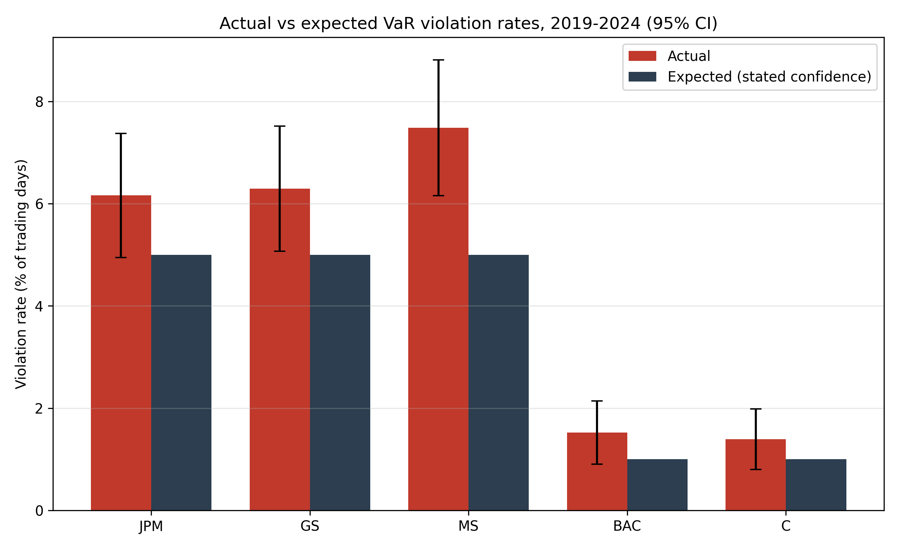
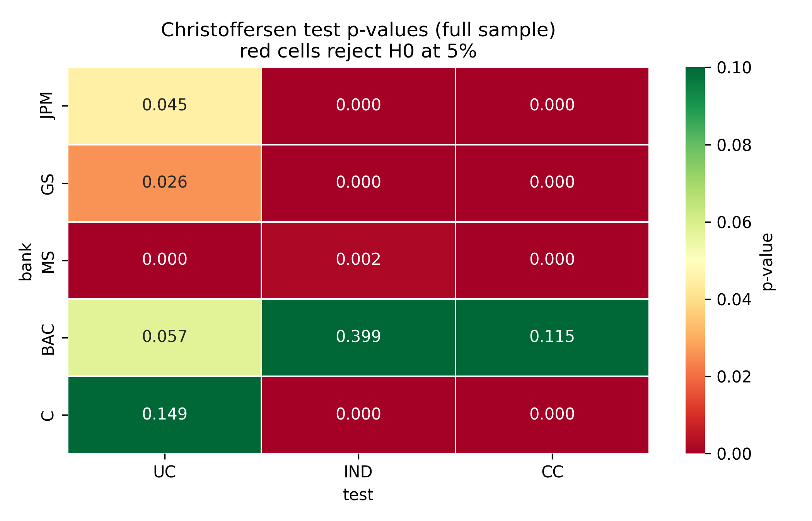
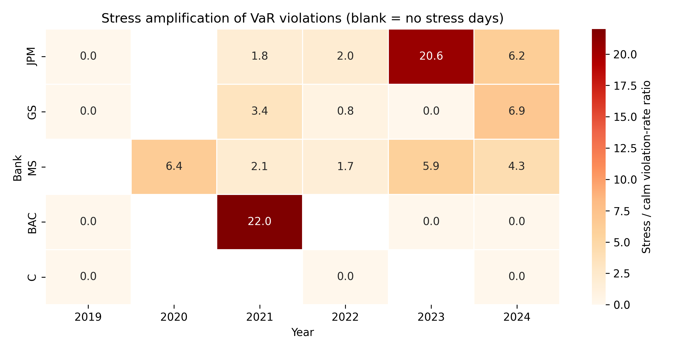

# var-confidence-audit

[](https://github.com/rxj0102/var-confidence-audit/actions/workflows/ci.yml)

**Do banks' disclosed VaR figures hold up?** This project audits the one-day
trading Value-at-Risk figures that five large U.S. banks (JPM, GS, MS, BAC, C)
publicly disclose in their quarterly 10-Q and annual 10-K SEC filings against
realized daily returns over 2019–2024. It scrapes the disclosures from SEC
EDGAR, normalizes them into return space, runs the canonical Kupiec (1995)
proportion-of-failures and Christoffersen (1998) conditional-coverage
backtests across calm and stressed (VIX > 25) regimes, benchmarks the
disclosed figures against three reimplemented VaR models (historical
simulation, parametric variance–covariance, RiskMetrics EWMA), and produces an
SSRN-ready research paper PDF plus an interactive Streamlit dashboard.

## Hypothesis

Disclosed VaR is, on average, conservatively calibrated (unconditional
coverage holds), **but** violations cluster in high-volatility regimes because
quarterly-average disclosures adapt too slowly, so the Christoffersen
independence and conditional-coverage tests reject even where the Kupiec
level test does not.

## Architecture

```
                 ┌─────────────────┐      ┌──────────────────────┐
                 │  data/fetch.py  │      │ data/scrape_edgar.py │
                 │ yfinance + FRED │      │  SEC EDGAR 10-Q/10-K │
                 └────────┬────────┘      └──────────┬───────────┘
                          │     data/raw/*.csv       │
                          └───────────┬──────────────┘
                                      ▼
                     ┌────────────────────────────────┐
                     │     analysis/violations.py     │
                     │  thresholds, violation panel   │
                     └───┬──────────┬─────────────┬───┘
                         ▼          ▼             ▼
            ┌────────────────┐ ┌──────────┐ ┌──────────────┐
            │christoffersen.py│ │ kupiec.py│ │comparison.py │
            └────────┬───────┘ └────┬─────┘ └──────┬───────┘
                     │   data/processed/*.csv      │
                     └──────────┬──────────────────┘
                                ▼
                  ┌──────────────────────────┐
                  │  backtest/var_models.py  │
                  │   HS / parametric / EWMA │
                  └────────────┬─────────────┘
                               ▼
        ┌──────────────────────┴───────────────────────┐
        ▼                                              ▼
┌──────────────────────┐                    ┌────────────────────┐
│paper/generate_paper.py│                   │  dashboard/app.py  │
│ outputs/paper/*.pdf  │                    │  Streamlit, 5 tabs │
└──────────────────────┘                    └────────────────────┘
```

## Setup

```bash
git clone https://github.com/rxj0102/var-confidence-audit.git
cd var-confidence-audit
python -m venv .venv && source .venv/bin/activate
pip install -r requirements.txt
```

Create a `.env` file in the project root (optional but recommended):

```ini
# FRED API key (free at https://fred.stlouisfed.org/docs/api/api_key.html).
# If omitted, the macro context series are skipped; the core audit still runs.
FRED_API_KEY=your_key_here

# SEC requires a declared User-Agent identifying you on EDGAR requests.
SEC_USER_AGENT=your-name your-email@example.com
```

## How to run

Run the pipeline in this exact order:

```bash
python data/fetch.py            # 1. prices, returns, VIX, FRED series
python data/scrape_edgar.py     # 2. VaR disclosures from SEC EDGAR
python analysis/violations.py   # 3. violation panel + summary
python analysis/christoffersen.py  # 4. UC / IND / CC tests
python analysis/kupiec.py       # 5. POF tests + non-rejection intervals
python analysis/comparison.py   # 6. cross-bank ranking, ANOVA, stress amp.
python backtest/var_models.py   # 7. HS / parametric / EWMA reimplementation
python paper/generate_paper.py  # 8. SSRN-ready PDF + figures appendix
streamlit run dashboard/app.py  # 9. interactive dashboard
```

Or explore interactively in `notebooks/research.ipynb`.

## Key findings

Generated by `scripts/render_readme.py` from `data/processed/` after a full pipeline run (`make reproduce`); CI checks that this section matches.

<!-- results:start (generated by scripts/render_readme.py, do not edit by hand) -->
Full sample 2019 to 2024, headline (absolute-return) violation definition. p-values below 0.05 reject.

| Bank | Stated rate | Actual rate | Kupiec p | Christoffersen IND p | CC p | Stress / calm violation ratio |
|---|---|---|---|---|---|---|
| BAC | 1% | 1.52% | 0.057 | 0.399 | 0.115 | 1.1x |
| C | 1% | 1.39% | 0.149 | 0.000 | 0.000 | 7.6x |
| GS | 5% | 6.30% | 0.026 | 0.000 | 0.000 | 2.2x |
| JPM | 5% | 6.16% | 0.045 | 0.000 | 0.000 | 2.3x |
| MS | 5% | 7.49% | 0.000 | 0.002 | 0.000 | 2.1x |

**Placebo test** (`analysis/placebo.py`): the same tests on thresholds with the same average level per bank. mcap_only keeps the market-cap scaling but replaces disclosed VaR with the bank's sample average; constant uses one fixed threshold.

| Bank | Stress / calm ratio: disclosed | mcap_only | constant | Clustering LR_ind: disclosed | mcap_only | constant |
|---|---|---|---|---|---|---|
| BAC | 1.1x | 15.3x | 53.5x | 0.7 | 3.7 | 38.0 |
| C | 7.6x | 13.4x | 53.5x | 21.3 | 11.5 | 13.5 |
| GS | 2.2x | 2.5x | 7.8x | 13.9 | 10.6 | 29.6 |
| JPM | 2.3x | 6.0x | 11.7x | 36.9 | 21.7 | 70.1 |
| MS | 2.1x | 3.3x | 7.5x | 9.9 | 3.9 | 30.0 |

- Conditional coverage rejects at 5% for 4 of 5 banks.
- Disclosed VaR has a lower stress / calm violation ratio than a constant threshold for 5 of 5 banks, so the disclosures do respond to stress rather than ignoring it.
- On clustering, disclosed VaR beats the mcap_only placebo, which contains no disclosure information, for 1 of 5 banks. Independence rejections therefore cannot be attributed to the banks' VaR models: much of the threshold's movement comes from the market-cap scaling, which rises when the bank's own stock falls.
<!-- results:end -->

How to read these results:

- **The level is tuned to the data.** `TRADING_INTENSITY` in `config.py` is calibrated so each bank's average threshold matches the empirical quantile of its own absolute returns. Kupiec and UC results therefore say little about whether banks calibrate VaR well; they mostly reflect that tuning.
- **Equity returns stand in for trading P&L.** Bank stock returns respond to far more than the trading book, so violations measure how a disclosed trading VaR, rescaled, lines up with equity risk.
- **Use the placebo rows to judge the clustering results.** A finding counts as evidence about the disclosures only if disclosed VaR behaves differently from a threshold that ignores them.





## Data sources

| Source | Content |
|---|---|
| [SEC EDGAR](https://www.sec.gov/edgar) | 10-Q / 10-K VaR disclosures (submissions API + full-text search) |
| [Yahoo Finance](https://finance.yahoo.com) (yfinance) | Daily adjusted close prices, VIX |
| [FRED](https://fred.stlouisfed.org) | BAMLH0A0HYM2 (HY OAS), DFEDTARU (fed funds upper bound) |

Scraping respects SEC fair-access guidance: declared User-Agent, 2-second
spacing between requests, exponential-backoff retry (max 3 attempts).

## Regulatory context

Under the Basel III internal-models approach, banks backtest one-day 99% VaR
against the last 250 days of P&L. The **traffic-light system** assigns ≤ 4
exceptions to the green zone, 5–9 to yellow (rising capital multiplier), and
≥ 10 to red (presumed model failure). That test checks only *unconditional*
coverage; this project additionally audits *independence* of violations —
the dimension on which quarterly-average disclosures are weakest.

## Caveats

Daily equity log returns proxy for (non-public) trading P&L, and disclosed
dollar VaR is normalized by a market-cap-based trading-equity assumption.
Results speak most credibly to the *dynamics* (clustering, stress
sensitivity) of disclosed VaR rather than its literal regulatory level.
Quarters whose disclosures could not be machine-read are linearly
interpolated and flagged (`interpolated_flag`).

## Citation

```bibtex
@unpublished{varconfidenceaudit2026,
  title  = {Do Banks' Disclosed VaR Figures Hold Up?
            An Empirical Audit of 10-Q Backtesting Disclosures},
  author = {[Author Name]},
  note   = {Working paper, Fox School of Business, Temple University},
  year   = {2026}
}
```

## Reproducibility

### Data availability

All inputs come from free, public sources. No paid data or API keys are required unless noted.

- Yahoo Finance via the yfinance package (free, no key)
- FRED, Federal Reserve Bank of St. Louis (free)
- SEC EDGAR filings (free, requires a User-Agent header)
- Files shipped in the `data/` folder of this repository

### Computational requirements

- Python 3.12.3. Every dependency version is pinned in `uv.lock`.
- Checked on Linux x86_64 with 2 CPU cores and 8 GB RAM. No GPU is needed.

```bash
pip install uv     # once
uv sync            # installs the exact pinned environment
uv run pytest -q   # runs the test suite
```

### Runtime

The test suite (15 tests) finishes in about 16 seconds on the machine above, including any data downloads it triggers.

### Citation

Citation metadata is in `CITATION.cff`. GitHub turns it into a Cite this repository button on the repo page.


## License

MIT — see [LICENSE](LICENSE).

## Methodology fixes and testing

- **Independence test on subsamples.** The stress/calm Christoffersen tests previously treated violations on non-adjacent trading days as consecutive. Transitions are now counted only between consecutive trading days.
- **Model backtests use loss-side violations** (`return < -VaR`). Counting `|return| > VaR` roughly doubles the violation rate of a correctly calibrated 99% model, so every reimplemented model used to look miscalibrated under Kupiec. The disclosed-VaR audit keeps its conservative absolute-return definition for the headline numbers; a `loss_violation` column and a `disclosed_loss_side` row in `model_comparison.csv` give the like-for-like version.
- **Missing VIX** is no longer silently labelled "high" regime.
- `pytest` covers Kupiec/Christoffersen statistics, the adjacency rule, VaR forecast timing (no look-ahead) and the violation definitions.
- `model_comparison.csv`, `model_var_estimates.csv` and the `model_*` figures were regenerated on 2026-11-07 under the loss-side violation definition (for example, JPM historical simulation 99% violation rate fell from 3.4% to 2.1%). The reported-VaR tables (`violation_summary`, `kupiec_results`, `christoffersen_results`, `cross_bank_comparison`, `stress_amplification`, `methodology_anova`, `daily_violations`), their figures and the paper still predate the fixes: they need the SEC EDGAR scrape (`python data/scrape_edgar.py`), which could not run in the sandbox. Rerun steps 2 to 8 locally to refresh them.
