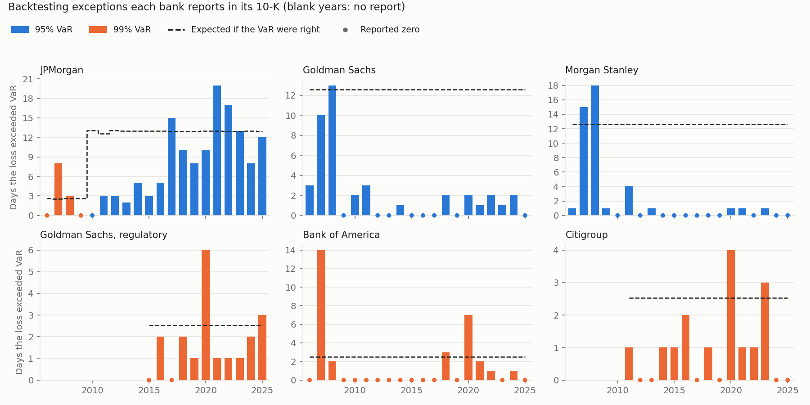

# Do banks' trading VaR models hold up?

[](https://github.com/rxj0102/var-confidence-audit/actions/workflows/ci.yml)

**Question.** Every large US bank publishes a one-day Value-at-Risk for its trading book and says how confident it is: 95% or 99%. Each bank also checks its model every day against what the book actually lost, and reports in its 10-K how many days the loss was larger than the VaR. A 95% VaR should be beaten about 13 times a year, a 99% VaR two or three times. Do the reported counts match?

<!-- headline:start (generated by scripts/render_readme.py, do not edit by hand) -->
**Answer, from 106 bank-years of backtesting results the five banks report in their 10-K filings, 2006 to 2025: on average the models are too cautious, and in a crisis they are too thin.** A 95% VaR should be exceeded on about 5% of days. Across the banks that use one, it was exceeded 219 times where 711 were expected, and not one bank-year had significantly too many. Goldman Sachs and Morgan Stanley run at about a sixth of the nominal rate. The 99% VaRs were exceeded 75 times against 126 expected. But the misses come together: in 2007, 2008 and 2020 the 99% models were exceeded 2.5 times as often as they should be, and in every other year 0.29 times. Part of the caution is how revenue is measured. Goldman's second backtest, which drops intraday trading from the P&L, is exceeded at 0.69 of the 99% rate and is not significantly off (p = 0.10).
<!-- headline:end -->

Every number on this page is written by `scripts/reproduce.py`, and CI fails if the page and the results disagree. Every count comes from a sentence in a 10-K, stored next to it in `data/disclosures.csv`.



## Results

<!-- results:start (generated by scripts/render_readme.py, do not edit by hand) -->
106 bank-years from 94 10-K filings. Trading days are taken from the filing where stated (18 rows) and set to 252 otherwise. Expected is (1 minus confidence) times trading days. The p-value tests the total against expected, exactly. Kupiec counts are bank-years where the year alone rejects at 5%, in each direction.

### By bank

| Bank and VaR | Years | Exceptions | Expected | Ratio | p | Years with too few | Years with too many | Years with none |
|---|---|---|---|---|---|---|---|---|
| JPMorgan, 99%, 2006 to 2009 | 4 | 11 | 10.3 | 1.06 | 0.75 | 2 | 1 | 2 |
| JPMorgan, 95%, 2010 to 2025 | 16 | 134 | 207.3 | 0.65 | below 0.0001 | 7 | 0 | 1 |
| Goldman Sachs, 95%, 2006 to 2025 | 20 | 42 | 252.0 | 0.17 | below 0.0001 | 18 | 0 | 8 |
| Morgan Stanley, 95%, 2006 to 2025 | 20 | 43 | 252.0 | 0.17 | below 0.0001 | 18 | 0 | 11 |
| Goldman Sachs, regulatory, 99%, 2015 to 2025 | 11 | 19 | 27.7 | 0.69 | 0.10 | 2 | 0 | 2 |
| Bank of America, 99%, 2006 to 2025 | 20 | 30 | 50.4 | 0.60 | 0.0028 | 13 | 2 | 13 |
| Citigroup, 99%, 2011 to 2025 | 15 | 15 | 37.8 | 0.40 | below 0.0001 | 6 | 0 | 6 |

### By confidence level

| VaR | Bank-years | Exceptions | Expected | Ratio | p | Too few | Too many |
|---|---|---|---|---|---|---|---|
| 95% | 56 | 219 | 711.3 | 0.31 | below 0.0001 | 43 | 0 |
| 99% | 50 | 75 | 126.3 | 0.59 | below 0.0001 | 23 | 3 |

### Stress years (2007, 2008, 2020) against the rest

| VaR | Years | Bank-years | Exceptions | Expected | Ratio |
|---|---|---|---|---|---|
| 95% | Stress | 7 | 69 | 88.6 | 0.78 |
| 95% | Other | 49 | 150 | 622.7 | 0.24 |
| 99% | Stress | 7 | 44 | 17.7 | 2.48 |
| 99% | Other | 43 | 31 | 108.5 | 0.29 |

### Do exceptions bunch in time?

Dispersion of the yearly counts around each series' own average rate. Under independent days the statistic is chi-square with years minus one degrees of freedom; a small p means the misses arrive in bunches.

| Bank and VaR | Statistic | Degrees of freedom | p | Worst year |
|---|---|---|---|---|
| JPMorgan, 99% | 16.3 | 3 | 0.0010 | 2007 (8) |
| JPMorgan, 95% | 63.4 | 15 | below 0.0001 | 2021 (20) |
| Goldman Sachs, 95% | 106.5 | 19 | below 0.0001 | 2008 (13) |
| Morgan Stanley, 95% | 224.5 | 19 | below 0.0001 | 2008 (18) |
| Goldman Sachs, regulatory, 99% | 16.4 | 10 | 0.09 | 2020 (6) |
| Bank of America, 99% | 146.9 | 19 | below 0.0001 | 2007 (14) |
| Citigroup, 99% | 20.1 | 14 | 0.13 | 2020 (4) |

**Basel traffic light, 99% series.** Of 50 bank-years, 46 are green, 3 yellow and 1 red: BAC 2007 (14), BAC 2020 (7), GS 2020 (6), JPM 2007 (8).
<!-- results:end -->

## Reading the results

- **Cautious on average, and that is the wrong thing to check.** A VaR that is exceeded too rarely ties up capital but does not hide risk, and averages over twenty years are dominated by calm ones. What matters to a risk manager is whether the model holds when markets turn, and the counts show it does not: the misses arrive together, in the years when they cost the most.
- **The revenue that is compared with VaR matters.** Goldman Sachs and Morgan Stanley compare VaR with trading revenue that includes intraday trading and bid-offer income, which is positive on most days. That alone pushes losses below the VaR. Goldman says so in its filings. Its second backtest, against positional P&L only, lands much closer to the nominal rate.
- **JPMorgan is the exception that looks like a working model.** Its 95% VaR is exceeded at about two thirds of the expected rate. For its highest counts, in 2020 and late 2021, the bank's own explanation is that volatility rose above the 12 months of history its model uses.
- **Historical windows are built to be late.** JPMorgan sizes its VaR from the last 12 months; Morgan Stanley said in 2008 that it used four years, equally weighted. A model fitted to past returns understates risk when volatility jumps and overstates it once markets calm, and bunched exceptions are what that produces.
- **Basel only looks at one side.** The regulatory traffic light raises capital for too many exceptions in a 250 day window and does nothing about too few. Almost every bank-year here is green, so the test that sets capital says little about how well these models track risk.

## Design

| Choice | What and why |
|---|---|
| Banks | JPMorgan Chase, Goldman Sachs, Morgan Stanley, Bank of America, Citigroup. |
| Source | Every 10-K filed since 2007 on SEC EDGAR, text extracted from the filing and any annual report attached as Exhibit 13. |
| Counts | For each bank-year, the sentence in that year's 10-K that states how many days the trading loss exceeded VaR. The counts were read from those sentences and recorded in `src/disclosures.py` with a phrase that occurs once in the filing. `scripts/build_disclosures.py` copies the full sentence and fails if it does not state the count. |
| Confidence | As the bank states it for that backtest. JPMorgan reported a 99% investment bank VaR until 2009 and a 95% firm VaR after; each year carries its own level. |
| Series | One backtest per bank, as reported. Goldman also reports a 99% regulatory backtest against positional P&L from 2015, kept as a second series. |
| Tests | Exact binomial test of the total, Kupiec test per year, a dispersion test across years, and the Basel traffic light for the 99% series. |
| Stress years | 2007, 2008 and 2020, chosen as the standard crisis years before the split was computed. |

## What was wrong with the first version

It asked the right question and could not answer it. It compared each bank's disclosed VaR with the daily return on the bank's own stock, which responds to far more than the trading book. To put the two on one scale it divided VaR by an assumed trading share of market value, and that assumption was calibrated so each bank's average threshold matched its own stock's return distribution, which made the coverage test circular. Quarters the scraper could not read were filled by interpolation or from a hard-coded table of approximate values. None of that survives. The banks report the comparison that matters themselves, and this version reads it.

## Limits

- **Five banks.** They are the largest US trading banks, not a sample of all of them.
- **Annual counts only.** Clustering within a year, the usual independence test, needs daily data that banks show only as charts. The dispersion test here looks at clustering across years.
- **Definitions change.** Banks changed what revenue they compare with VaR, which VaR they report, and their models, several times over twenty years. Each count is used as reported for its year.
- **Trading days.** Only JPMorgan states the number of trading days; elsewhere 252 is used. That moves expected counts by a fraction of one exception.
- **Missing years.** Citigroup reported no count before 2011.
- **One count is a floor.** Bank of America's 2007 count of 14 excludes discrete CDO writedowns.

## Reproduce

```bash
pip install -r requirements.txt
python -m pytest -q               # tests
python scripts/reproduce.py       # seconds, rewrites results/
python scripts/render_readme.py   # rewrites this page; --check compares only
```

To rebuild `data/disclosures.csv` from EDGAR, which asks every client to identify itself:

```bash
export EDGAR_USER_AGENT="Your Name your.address@example.com"
python scripts/fetch_filings.py      # about 400 filings, cached under data/raw/edgar
python scripts/build_disclosures.py
```

## Layout

```
src/disclosures.py          which sentence of which 10-K each count comes from
src/study.py                expected counts, binomial, Kupiec and dispersion tests, Basel zones
scripts/fetch_filings.py    EDGAR download and text extraction
scripts/build_disclosures.py  data/disclosures.csv from the cached filings
scripts/reproduce.py        results/ from data/disclosures.csv
scripts/render_readme.py    this page from results/
tests/                      source checks and statistics
```

## References

- Basel Committee on Banking Supervision (1996). Supervisory framework for the use of backtesting in conjunction with the internal models approach to market risk capital requirements.
- Berkowitz, J. and O'Brien, J. (2002). How accurate are value-at-risk models at commercial banks? *Journal of Finance* 57(3).
- Kupiec, P. (1995). Techniques for verifying the accuracy of risk measurement models. *Journal of Derivatives* 3(2).
- Pérignon, C. and Smith, D. (2010). The level and quality of Value-at-Risk disclosure by commercial banks. *Journal of Banking and Finance* 34(2).
